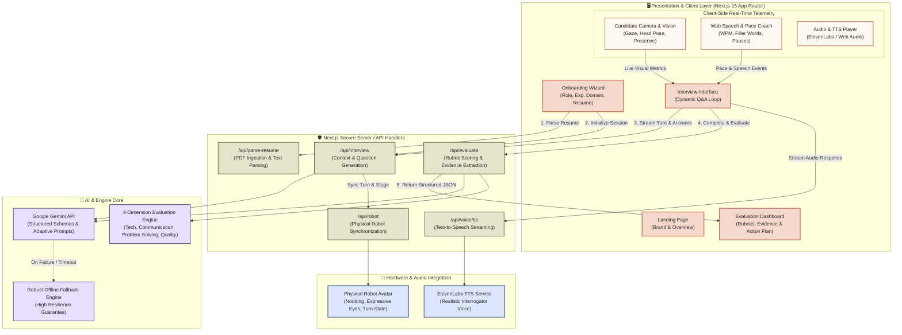
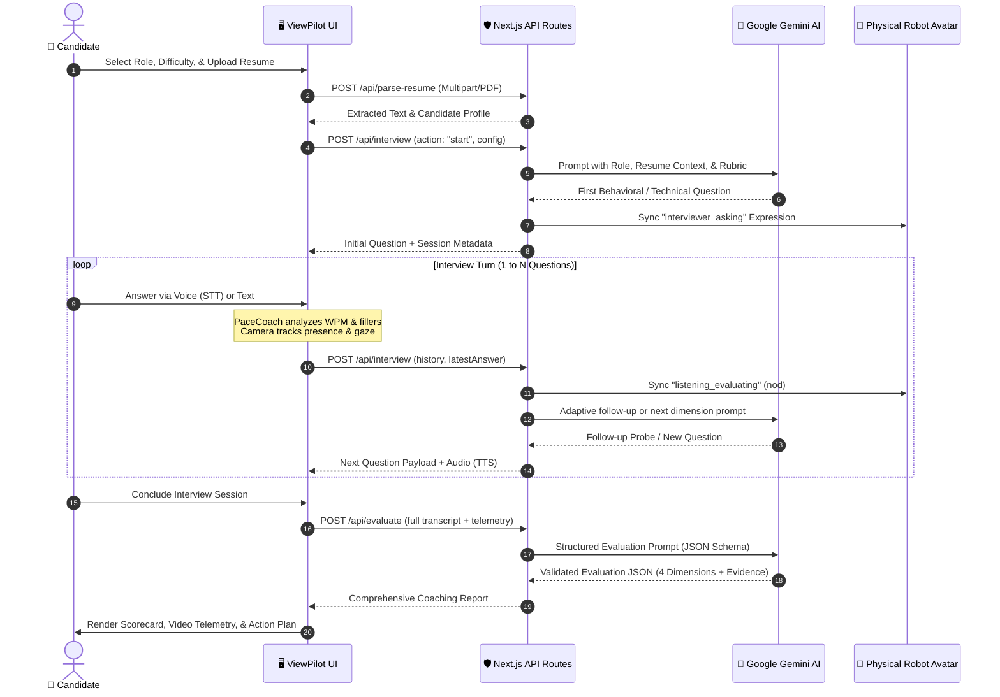

# 🏆 ViewPilot — AI-Powered Adaptive Interview Platform

> **Team MoonCraft | CodeFest 2026**  
> *Problem Statement #2: AI-Powered Web Applications × Job Readiness*

[](https://nextjs.org/)
[](https://ai.google.dev/)
[](https://www.typescriptlang.org/)
[](https://tailwindcss.com/)
[](https://m3.material.io/)

---

## 📖 Overview

**ViewPilot** is an intelligent, real-time mock interview and job readiness coach designed to bridge the gap between academic preparation and competitive hiring standards. Powered by **Google Gemini** and modern web-native telemetry, ViewPilot delivers adaptive, conversational interviews tailored to the candidate's target role, experience level, and uploaded resume.

Beyond basic text Q&A, ViewPilot provides:
- **Adaptive Multi-Turn Questioning**: Dynamic follow-up probes based on candidates' responses and STAR method completeness.
- **Client-Side Real-Time Telemetry**: Real-time speech rate (WPM) tracking, filler word detection, and candidate video presence/gaze indicators.
- **Evidence-Backed Scorecards**: Multi-dimensional rubrics (Technical, Communication, Problem Solving, Answer Quality) citing direct transcript quotes.
- **Physical Robot Avatar Synchronization**: Hardware-ready webhook bridge for physical robotic interview companions (`/api/robot`).
- **Zero API Key Leakage**: All generative models and external services are strictly routed through isolated server-side handlers.

---

## 🏗️ System Architecture

ViewPilot is architected with clear boundaries between the **Client Presentation & Telemetry Layer**, the **Secure Next.js Server Layer**, the **AI & Evaluation Engines**, and **External Hardware/Speech Bridges**.



---

## 🔄 End-to-End Interview & Evaluation Flow

The following sequence illustrates how a candidate session progresses from onboarding to final rubric scoring:



---

## 🔑 Key Architectural Highlights

### 1. Zero-Browser Secret Exposure
Client browsers never interact directly with LLM or TTS providers. All communications flow through Next.js App Router API handlers (`/api/*`), shielding private credentials, API keys, and internal prompt templates.

### 2. Multi-Modal Client-Side Telemetry
- **Video Presence & Gaze Estimation**: Non-invasive computer-vision heuristics measure candidate face centering, posture stability, and gaze engagement.
- **Pace Coach**: Real-time calculation of words-per-minute (WPM), filler word frequency (`"um"`, `"uh"`, `"like"`), and pause duration via browser Web Speech API.

### 3. Structured 4-Dimensional Scoring Rubric
Evaluations are strictly enforced through Zod schemas matching our 4 primary axes:
- **Technical Acumen**: Domain precision, accuracy, and depth of technical answers.
- **Communication & Delivery**: Clarity, concise phrasing, structured answers (STAR method), and pace.
- **Problem Solving & Critical Thinking**: Handling edge cases, assumptions, and methodical breakdown.
- **Answer Quality & Completeness**: Relevance, evidence, depth, and actionable takeaways.

### 4. Hardware Avatar Bridge (`/api/robot`)
Allows ViewPilot to drive physical desktop robotic companions or local animatronics via HTTP/LAN endpoints, syncing physical head movements, nodding, and eye expressions to active interview phases.

---

## 📂 Project Structure

```text
├── app/
│   ├── api/
│   │   ├── evaluate/          # Final rubric generation & evidence extraction
│   │   ├── interview/         # Adaptive question and follow-up engine
│   │   ├── parse-resume/      # Local PDF parser & resume extraction
│   │   ├── robot/             # Physical robot companion sync endpoint
│   │   └── voice/tts/         # Audio generation & streaming endpoint
│   ├── interview/             # Real-time interview chat interface
│   ├── report/                # Rich evaluation report & coaching dashboard
│   ├── setup/                 # Multi-step onboarding wizard
│   ├── globals.css            # Material 3 Expressive theme tokens
│   └── page.tsx               # Product landing page & entry
├── components/
│   ├── CandidateCamera.tsx    # Live camera view & gaze estimation
│   ├── ChatMessage.tsx        # Structured message bubbles with status
│   ├── CoachingTips.tsx       # Live inline suggestions
│   ├── CommunicationTelemetry.tsx # WPM & speech metrics visualizer
│   ├── EvidencePanel.tsx      # Quoted transcript evidence breakdown
│   ├── OnboardingWizard.tsx   # Step-by-step role configuration
│   ├── PaceCoach.tsx          # Real-time cadence coach
│   ├── ScoreCard.tsx          # Dimensional grading breakdown
│   └── ui/                    # Reusable pill buttons, cards, and chips
├── lib/
│   ├── gemini.ts              # Gemini SDK client & prompt orchestrator
│   ├── prompts.ts             # System prompts with structured instructions
│   ├── robot/                 # Hardware client & protocol bridges
│   ├── schemas.ts             # Zod validation schemas
│   └── fallback-data.ts       # Deterministic fallback responses
```

---

## 🚀 Getting Started

### Prerequisites
- **Node.js**: v18.18.0 or newer
- **npm** / **pnpm** / **yarn**
- **Google Gemini API Key** ([Google AI Studio](https://aistudio.google.com/))

### 1. Clone & Install
```bash
git clone https://github.com/Itsmeakash248/CodeFest-FINAL.git
cd CodeFest-FINAL
npm install
```

### 2. Configure Environment Variables
Create or verify `.env.local`:
```bash
# Server-Side Only Credentials
GEMINI_API_KEY=your_gemini_api_key_here

# Optional: ElevenLabs for Ultra-Realistic Voice
ELEVENLABS_API_KEY=your_elevenlabs_key_here
ELEVENLABS_VOICE_ID=XrExE9yKIg1WjnnlVkGX

# Optional: LAN Robot Bridge
# ROBOT_BASE_URL=http://192.168.1.42
```

### 3. Run Development Server
```bash
npm run dev
```
Open [http://localhost:3000](http://localhost:3000) in your browser.

---

## 👥 Built with ❤️ by Team MoonCraft
CodeFest 2026 — AI-Powered Web Applications × Job Readiness
