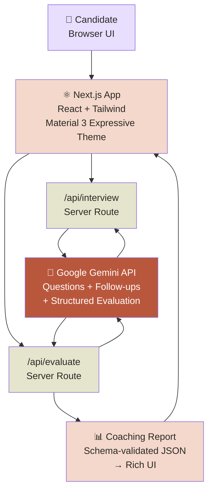
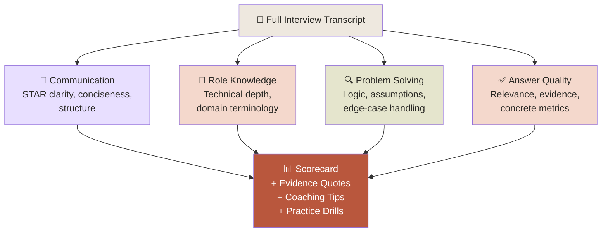

# 🏆 ViewPilot — Ultimate CodeFest 2026 Hackathon Battle Plan

> [!IMPORTANT]
> **Hackathon Date:** 24 October 2026 — **TODAY**
> **Registration:** 8:00 AM → Hackathon starts **8:30 AM** → Evaluation at **2:30 PM**
> **Total build time: ~6 hours** (8:30 AM – 2:30 PM)
> **Problem Statement #2:** AI-Powered Web Applications × Job Readiness

---

## 📊 Intelligence Summary — What the Judges Want

From the problem statement, the judging criteria maps directly to these **must-demonstrate** capabilities:

| Requirement from PS | What to Build | Priority |
|---|---|---|
| Choose target job role, experience level, interview type, difficulty | Multi-step onboarding wizard | 🔴 P0 |
| Relevant interview questions should be asked | Gemini-powered adaptive question generation | 🔴 P0 |
| Interactive interviews conducted | Real-time conversational interview loop | 🔴 P0 |
| Analyze and evaluate user answers | Structured rubric-based scoring (4 dimensions) | 🔴 P0 |
| Personalized feedback on communication, technical, problem-solving, answer quality | Evidence-backed scorecard with transcript quotes | 🔴 P0 |
| Adaptive questions | Follow-up questions based on previous answers | 🔴 P0 |
| Resume-based personalization | Resume upload → tailored questions | 🟡 P1 |
| Voice-based interviewing | Web Speech API integration | 🟡 P1 |
| Automated answer evaluation | Already in P0 rubric system | ✅ Covered |
| Performance analysis | Visual dashboard with dimension breakdown | 🟡 P1 |
| Novel approaches encouraged | Real-time pace coaching, exportable PDF | 🟢 P2 |

---

## ⏱️ Minute-by-Minute Execution Timeline

```mermaid
flowchart LR
    A["8:00-8:30\nRegistration\n+ Setup"] --> B["8:30-9:30\nPhase 1\nFoundation"]
    B --> C["9:30-10:30\nPhase 2\nInterview Engine"]
    C --> D["10:30-10:45\n☕ Tea Break"]
    D --> E["10:45-12:00\nPhase 3\nEvaluation + Report"]
    E --> F["12:00-12:30\n🍽️ Lunch + Review"]
    F --> G["12:30-1:30\nPhase 4\nPolish + P1s"]
    G --> H["1:30-2:15\nPhase 5\nDemo Prep"]
    H --> I["2:30\n🎯 EVALUATION"]

    style A fill:#E8DFFF,color:#292824
    style B fill:#F4D8CC,color:#292824
    style C fill:#F4D8CC,color:#292824
    style D fill:#E5E5CD,color:#292824
    style E fill:#F4D8CC,color:#292824
    style F fill:#E5E5CD,color:#292824
    style G fill:#F4D8CC,color:#292824
    style H fill:#FFDAD0,color:#292824
    style I fill:#B9573D,color:#FFFFFF
```



---

### Phase 1 — Foundation (8:30–9:30) — 60 min

| Task | Owner | Time |
|---|---|---|
| `npx create-next-app@latest viewpilot --ts --tailwind --app --eslint` | Dev | 5 min |
| Set up project structure: `/app`, `/components`, `/lib`, `/types` | Dev | 5 min |
| Install dependencies: `@google/generative-ai`, `lucide-react`, `framer-motion` | Dev | 5 min |
| Implement the **design system** from [claude-material-expressive-theme-design.md](file:///home/akash/Documents/CodeFest-FINAL/claude-material-expressive-theme-design.md): CSS variables, theme tokens, Tailwind config | Dev | 15 min |
| Build reusable UI components: Button (pill), Card (28px radius), TextField, Chip | Dev | 15 min |
| Create landing page with MoonCraft branding + logo | Dev | 15 min |

**Deliverable:** Running Next.js app with design system, theme, and landing page.

### Phase 2 — Interview Engine Core (9:30–10:30) — 60 min

| Task | Owner | Time |
|---|---|---|
| Build **Onboarding Wizard** (4-step): Role → Experience → Type → Difficulty | Dev | 20 min |
| Create Gemini API server route (`/api/interview`) with system prompt engineering | Dev | 15 min |
| Build **Interview Chat UI** — one question at a time with follow-ups | Dev | 20 min |
| Wire up conversation state management (context array for multi-turn) | Dev | 5 min |

**Deliverable:** Full working interview loop — user configures → AI asks → user answers → AI follows up.

### ☕ Tea Break (10:30–10:45) — 15 min
> Quick review: Test the interview loop end-to-end. Note any bugs.

### Phase 3 — Evaluation & Report Engine (10:45–12:00) — 75 min

| Task | Owner | Time |
|---|---|---|
| Design Gemini evaluation prompt with **structured JSON schema output** | Dev | 15 min |
| Build server route `/api/evaluate` — sends full transcript → gets structured rubric | Dev | 10 min |
| Build **Scorecard UI**: 4 dimensions with scores, progress bars, color coding | Dev | 20 min |
| Build **Evidence Panel**: transcript quotes highlighted per dimension | Dev | 15 min |
| Build **Improvement Section**: 2-3 micro-actions + rewritten answer blueprints | Dev | 15 min |

**Deliverable:** Complete coaching report with transparent scores, evidence, and actionable improvement.

### 🍽️ Lunch + Review (12:00–12:30) — 30 min
> Full flow test: Onboarding → Interview → Report. Fix critical bugs.

### Phase 4 — Polish & P1 Features (12:30–1:30) — 60 min

| Task | Owner | Time |
|---|---|---|
| **Resume upload** — parse text, feed to Gemini for personalized questions | Dev | 15 min |
| **Voice mode** — Web Speech API for speech-to-text input (optional toggle) | Dev | 15 min |
| **Responsive polish** — mobile-friendly layouts, animations, loading states | Dev | 15 min |
| **Dark mode** toggle using the design spec's dark theme tokens | Dev | 10 min |
| Error handling, edge cases, empty states with helpful copy | Dev | 5 min |

**Deliverable:** Polished product with P1 differentiators.

### Phase 5 — Demo Preparation (1:30–2:15) — 45 min

| Task | Owner | Time |
|---|---|---|
| Prepare **golden path demo script** (see Demo Script below) | All | 10 min |
| Do 3 full dry-run demos, time each one | All | 20 min |
| Prepare backup: pre-recorded screenshots/GIFs in case of API issues | Dev | 10 min |
| Final deploy to Vercel (or have local `npm run dev` ready) | Dev | 5 min |

---

## 🏗️ System Architecture



> [!NOTE]
> **Zero API keys exposed to the browser.** All Gemini calls go through Next.js server routes. This is a security talking point during the demo.

---

## 🎨 Design System — The Visual Edge

Your [design spec](file:///home/akash/Documents/CodeFest-FINAL/claude-material-expressive-theme-design.md) is a **massive competitive advantage**. Most hackathon projects look generic. Yours will look like a shipped product.

### Key Visual Tokens to Implement

```css
:root {
  /* Light Theme — Claude × Material 3 Expressive */
  --background: #F7F3EC;
  --surface: #FFFCF7;
  --surface-container: #EEE8DF;
  --text-primary: #292824;
  --text-secondary: #6D675F;
  --outline: #C9C0B5;
  --primary: #B9573D;        /* Terracotta — hero accent */
  --on-primary: #FFFFFF;
  --primary-container: #F4D8CC;
  --secondary: #686B4E;
  --tertiary: #625B8A;        /* Lavender — sparingly */
  --tertiary-container: #E8DFFF;
  --success: #386A4A;
  --warning: #8A5B16;
  --error: #B3261E;
}
```

### Design Differentiators to Nail

| Element | Implementation |
|---|---|
| Buttons | **Pill-shaped** (`rounded-full`), terracotta fill |
| Cards | **28px radius** (`rounded-3xl`), warm cream, subtle tonal elevation |
| Text fields | **20-24px radius**, generous padding, clear focus ring |
| Typography | Roboto Flex for UI, optional Georgia for hero headings |
| Motion | 120-180ms micro, 200-280ms transitions, spring for expressive elements |
| Spacing | 4/8/12/16/24/32/40/48px scale |
| Logo | Use [Crescent Moon Orbital Star Emblem](file:///home/akash/Documents/CodeFest-FINAL/Crescent%20Moon%20Orbital%20Star%20Emblem.png) |

---

## 🎯 The 4-Dimension Evaluation Rubric (Core Differentiator)

This is what separates ViewPilot from a generic chatbot. The structured evaluation:



### Evaluation JSON Schema (for Gemini structured output)

```typescript
interface EvaluationReport {
  executiveSummary: string;
  overallScore: number; // 1-10
  dimensions: {
    communication: {
      score: number;
      criteria: string;
      evidence: string[];    // Exact transcript quotes
      coachingTip: string;
      practiceAction: string;
    };
    roleKnowledge: { /* same structure */ };
    problemSolving: { /* same structure */ };
    answerQuality: { /* same structure */ };
  };
  improvedAnswerBlueprint: string;
  nextSteps: string[];
}
```

---

## 🎬 Demo Script — The 3-Minute Winning Walkthrough

> [!TIP]
> **Hook the judges in the first 15 seconds.** Lead with the problem, not the tech.

### Opening (30 sec)
> *"Raise your hand if you've ever gone into an interview feeling unprepared. 80% of students don't practice because realistic practice isn't accessible. ViewPilot changes that."*

### Live Demo Flow (2 min)

| Step | What to Show | What to Say |
|---|---|---|
| 1. Landing | Beautiful themed landing page with MoonCraft branding | *"Clean, professional — this feels like a real product."* |
| 2. Onboarding | Select: **Frontend Developer**, **Junior**, **Behavioral**, **Medium** | *"30 seconds to set up. No signup required."* |
| 3. Interview | AI asks a behavioral question → answer → smart follow-up | *"Notice the follow-up — it's not a generic next question, it probes deeper based on my answer."* |
| 4. Report | Show the 4-dimension scorecard with scores + evidence | *"Every score shows WHY. Exact quotes from my answers. No mystery."* |
| 5. Coaching | Show the improvement tips + rewritten answer blueprint | *"This is the breakthrough — not just what's wrong, but exactly how to fix it."* |

### Closing (30 sec)
> *"ViewPilot is coaching, never gatekeeping. No demographic scoring. No accent evaluation. Server-isolated API keys. Privacy-first. We built this because every student deserves a practice partner who makes them better."*

---

## 🔑 Judge-Winning Talking Points

These are the differentiators that win hackathons. **Weave these in naturally during the demo:**

### 1. "Coaching, Never Gatekeeping"
> We're not predicting if someone will get hired. We're making them better. That's an ethical line we drew in the architecture.

### 2. "Evidence, Not Mystery Scores"
> Every point on the rubric ties to an exact quote from the candidate's transcript. You can see WHY you got a 6 in communication.

### 3. "Schema-Validated AI Output"
> We don't just pipe raw LLM text to the screen. We enforce a JSON schema so every evaluation is structured, parseable, and consistently formatted.

### 4. "Zero API Keys in the Browser"
> All Gemini calls go through server routes. No credentials leak to the frontend. This is production-grade security.

### 5. "Material 3 Expressive Design"
> We didn't use a default template. We designed a complete theme system — warm terracotta, editorial typography, pill buttons, oversized cards — this looks and feels like a shipped product.

---

## ⚠️ Risk Mitigation

| Risk | Mitigation |
|---|---|
| Gemini API is slow/down | Pre-cache a golden demo response. Have a fallback JSON file. |
| Internet goes down | Deploy locally with `npm run dev`. Have offline demo screenshots. |
| Gemini returns malformed JSON | JSON schema enforcement + `try/catch` with graceful error UI |
| Time runs short | P0 features are complete by 12:00. Everything after is bonus. |
| Demo nerves | 3 dry runs. Written script. Backup screenshots. |

---

## 📁 Project Structure

```
viewpilot/
├── app/
│   ├── layout.tsx              # Root layout + theme + fonts
│   ├── page.tsx                # Landing page
│   ├── setup/
│   │   └── page.tsx            # Onboarding wizard
│   ├── interview/
│   │   └── page.tsx            # Interview chat interface
│   ├── report/
│   │   └── page.tsx            # Evaluation report + coaching
│   └── api/
│       ├── interview/
│       │   └── route.ts        # Gemini interview API
│       └── evaluate/
│           └── route.ts        # Gemini evaluation API
├── components/
│   ├── ui/                     # Design system components
│   │   ├── Button.tsx
│   │   ├── Card.tsx
│   │   ├── TextField.tsx
│   │   ├── Chip.tsx
│   │   └── ProgressBar.tsx
│   ├── OnboardingWizard.tsx
│   ├── ChatMessage.tsx
│   ├── ScoreCard.tsx
│   ├── EvidencePanel.tsx
│   └── CoachingTips.tsx
├── lib/
│   ├── gemini.ts               # Gemini client + prompts
│   ├── prompts.ts              # System prompts for interview + eval
│   ├── schemas.ts              # TypeScript types + Zod schemas
│   └── theme.ts                # Theme tokens
├── public/
│   └── logo.png                # MoonCraft logo
├── tailwind.config.ts          # Custom theme with design tokens
└── .env.local                  # GEMINI_API_KEY (server only)
```

---

## 🧠 Gemini Prompt Engineering — The Secret Weapon

### Interview System Prompt (key excerpt)

```
You are ViewPilot, an expert interview coach. You are conducting a
{interviewType} interview for a {role} position at {experienceLevel} level.
Difficulty: {difficulty}.

RULES:
1. Ask ONE question at a time.
2. After each answer, decide: ask a FOLLOW-UP that probes deeper into
   the same topic, OR move to a NEW question.
3. Follow-ups should feel natural, like a real interviewer pressing
   for specifics.
4. Adapt difficulty based on answer quality.
5. After 5-7 questions, signal that the interview is complete.
6. Never break character. You ARE the interviewer.
```

### Evaluation System Prompt (key excerpt)

```
Evaluate the following interview transcript across exactly 4 dimensions.
Return ONLY valid JSON matching this schema: { ... }

RULES:
1. Every score MUST cite at least one exact verbatim quote from the transcript.
2. Coaching tips must be specific and actionable, not generic advice.
3. The improved answer blueprint must rewrite the candidate's weakest
   answer using their own context but better structure.
4. Be encouraging but honest. This is coaching, not gatekeeping.
```

---

## 🏁 Victory Checklist

- [ ] Beautiful landing page with MoonCraft branding + design system
- [ ] 4-step onboarding wizard (role, level, type, difficulty)
- [ ] Real-time adaptive interview with follow-up questions
- [ ] 4-dimension structured evaluation with evidence quotes
- [ ] Actionable coaching tips + improved answer blueprints
- [ ] Server-side API key isolation
- [ ] Responsive design + dark mode toggle
- [ ] Resume upload for personalized questions (P1 bonus)
- [ ] Voice input mode (P1 bonus)
- [ ] 3-minute demo script rehearsed 3× times
- [ ] Fallback demo materials ready

---

> [!CAUTION]
> **Time is your enemy.** The hackathon runs 8:30 AM – 2:30 PM. That's **6 hours**. The plan above is designed so P0 is **done by noon**, giving you 2.5 hours of buffer for polish, P1 features, and demo prep. **Do NOT start P1 features until P0 works end-to-end.** A polished MVP beats an incomplete feature set every time.

---

*Team MoonCraft — ViewPilot — CodeFest 2026* 🌙✨
