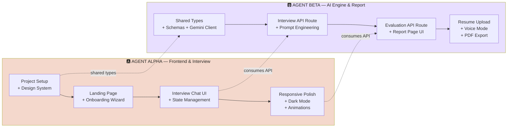

# ⚡ ViewPilot — Two-Agent Work Split

> [!IMPORTANT]
> **6 hours. 2 agents. Zero wasted overlap.**
> Agent Alpha owns the **frontend shell + interview UX**. Agent Beta owns the **AI engine + evaluation report**.
> They share a contract (TypeScript types) and merge at defined sync points.

---

## 🔀 The Split at a Glance



---

## 🅰️ Agent Alpha — Frontend Shell + Interview UX

> **Owns:** Project scaffolding, design system, all pages & UI components, interview chat interface
> **Files owned:** `app/layout.tsx`, `app/page.tsx`, `app/setup/`, `app/interview/`, `components/`, `tailwind.config.ts`, `public/`

### Phase 1 — Foundation (8:30–9:30)

| # | Task | Time | Files |
|---|---|---|---|
| A1 | `npx create-next-app@latest viewpilot --ts --tailwind --app --eslint` | 5 min | `/` |
| A2 | Install deps: `framer-motion`, `lucide-react`, `clsx` | 3 min | `package.json` |
| A3 | **Design system CSS variables** — full light + dark theme tokens from the spec | 12 min | `app/globals.css` |
| A4 | **Tailwind config** — extend with custom colors, radii, font families | 10 min | `tailwind.config.ts` |
| A5 | **Reusable UI components:** `Button` (pill), `Card` (28px radius), `TextField` (20px radius), `Chip` (pill), `ProgressBar` | 20 min | `components/ui/*` |
| A6 | **Root layout** — fonts (Roboto Flex + Georgia), metadata, theme provider shell | 5 min | `app/layout.tsx` |

### Phase 2 — Landing + Onboarding (9:30–10:30)

| # | Task | Time | Files |
|---|---|---|---|
| A7 | **Landing page** — hero section with logo, tagline, CTA pill button, feature cards | 20 min | `app/page.tsx` |
| A8 | **Onboarding Wizard** — 4-step stepper: Role → Experience Level → Interview Type → Difficulty. Animated transitions, Chip selectors, pill "Start Interview" button | 30 min | `app/setup/page.tsx`, `components/OnboardingWizard.tsx` |
| A9 | Store config in URL params or context → navigate to `/interview` | 10 min | `lib/interview-context.tsx` |

### ☕ Tea Break (10:30–10:45)

### Phase 3 — Interview Chat Interface (10:45–12:00)

| # | Task | Time | Files |
|---|---|---|---|
| A10 | **Chat UI layout** — message bubbles (AI left, user right), input composer at bottom, auto-scroll | 25 min | `app/interview/page.tsx`, `components/ChatMessage.tsx` |
| A11 | **Interview state machine** — loading states, typing indicator, question counter ("Q3 of 6"), end-of-interview detection | 20 min | `app/interview/page.tsx` |
| A12 | **Wire to Beta's `/api/interview` route** — send messages, receive AI response, manage conversation history array | 15 min | `app/interview/page.tsx` |
| A13 | **"End Interview → View Report" transition** — send full transcript to `/api/evaluate`, navigate to `/report` | 15 min | `app/interview/page.tsx` |

### 🍽️ Lunch + Sync (12:00–12:30)

### Phase 4 — Polish & Enhancements (12:30–1:30)

| # | Task | Time | Files |
|---|---|---|---|
| A14 | **Dark mode toggle** — CSS variable swap, persist in localStorage, smooth transition | 15 min | `components/ThemeToggle.tsx`, `app/globals.css` |
| A15 | **Responsive design pass** — mobile-first interview chat, stacked report cards, collapsible onboarding | 15 min | All pages |
| A16 | **Micro-animations** — framer-motion entrance animations on cards, page transitions, button hover/press states | 15 min | Components |
| A17 | **Loading & empty states** — skeleton loaders, "AI is thinking…" animation, error boundaries with recovery actions | 15 min | Components |

### Phase 5 — Demo Ready (1:30–2:15)

| # | Task | Time | Files |
|---|---|---|---|
| A18 | Final visual polish — spacing, alignment, font weights, consistent padding | 15 min | All |
| A19 | Prepare golden-path demo data (pre-filled onboarding selections for fast demo) | 10 min | — |
| A20 | 3× dry-run demos with timer | 20 min | — |

---

## 🅱️ Agent Beta — AI Engine + Evaluation Report

> **Owns:** Gemini integration, all API routes, prompt engineering, evaluation logic, report page, P1 features
> **Files owned:** `lib/gemini.ts`, `lib/prompts.ts`, `lib/schemas.ts`, `types/`, `app/api/`, `app/report/`

### Phase 1 — Shared Contracts + Gemini Client (8:30–9:30)

| # | Task | Time | Files |
|---|---|---|---|
| B1 | **TypeScript types + Zod schemas** — `InterviewConfig`, `ChatMessage`, `EvaluationReport`, `Dimension` | 15 min | `types/index.ts`, `lib/schemas.ts` |
| B2 | **Gemini client setup** — `GoogleGenerativeAI` init, model config, safety settings, helper functions | 10 min | `lib/gemini.ts` |
| B3 | **Interview system prompt** — role-aware, experience-aware, type-aware, adaptive follow-ups, 5-7 question limit | 20 min | `lib/prompts.ts` |
| B4 | **`/api/interview` route** — accepts conversation history + config, returns next AI question, handles multi-turn context | 15 min | `app/api/interview/route.ts` |

### Phase 2 — Interview API Hardening (9:30–10:30)

| # | Task | Time | Files |
|---|---|---|---|
| B5 | **Adaptive follow-up logic** — prompt instructs Gemini to probe deeper vs. move on based on answer quality | 15 min | `lib/prompts.ts` |
| B6 | **Interview flow control** — end-of-interview signal, question counter, graceful session wrap-up | 10 min | `app/api/interview/route.ts` |
| B7 | **Evaluation system prompt** — 4-dimension rubric, structured JSON output, evidence citation rules, coaching tone | 25 min | `lib/prompts.ts` |
| B8 | **`/api/evaluate` route** — accepts full transcript + config, returns `EvaluationReport` JSON, schema validation with Zod | 10 min | `app/api/evaluate/route.ts` |

### ☕ Tea Break (10:30–10:45)

### Phase 3 — Report Page UI (10:45–12:00)

| # | Task | Time | Files |
|---|---|---|---|
| B9 | **Report page layout** — executive summary banner, 4-dimension score grid | 20 min | `app/report/page.tsx` |
| B10 | **ScoreCard component** — circular/bar score visual, dimension name, criteria description, score out of 10 with color coding (green/yellow/red) | 20 min | `components/ScoreCard.tsx` |
| B11 | **EvidencePanel component** — collapsible sections per dimension showing exact transcript quotes with highlight styling | 15 min | `components/EvidencePanel.tsx` |
| B12 | **CoachingTips component** — actionable micro-tasks + improved answer blueprint in a styled card | 10 min | `components/CoachingTips.tsx` |
| B13 | **Wire report page** — consume evaluation API response, loading state while Gemini evaluates, error handling | 10 min | `app/report/page.tsx` |

### 🍽️ Lunch + Sync (12:00–12:30)

### Phase 4 — P1 Features (12:30–1:30)

| # | Task | Time | Files |
|---|---|---|---|
| B14 | **Resume upload** — file input → extract text (PDF parse) → inject into Gemini prompt for personalized questions | 20 min | `app/setup/page.tsx`, `app/api/parse-resume/route.ts` |
| B15 | **Voice input mode** — Web Speech API (`SpeechRecognition`) toggle on interview page, speech-to-text into composer | 20 min | `components/VoiceInput.tsx` |
| B16 | **Real-time pace coaching** — response timer, word count, pace indicator (too fast/slow/good) | 10 min | `components/PaceCoach.tsx` |
| B17 | **Fallback demo data** — pre-baked JSON responses for offline demo in case Gemini API is down | 10 min | `lib/fallback-data.ts` |

### Phase 5 — Integration & Demo (1:30–2:15)

| # | Task | Time | Files |
|---|---|---|---|
| B18 | **End-to-end integration test** — full flow with Alpha's UI: onboarding → interview → report | 15 min | — |
| B19 | **Error edge cases** — empty answers, API timeout, malformed Gemini response, network failure | 10 min | API routes |
| B20 | **Deploy to Vercel** (or ensure `npm run dev` stable on demo machine) | 10 min | — |
| B21 | Support Alpha's dry-run demos, fix any last integration bugs | 10 min | — |

---

## 🤝 Sync Points — Where They Meet

| Time | Sync Event | What Happens |
|---|---|---|
| **8:35 AM** | 🟢 **Contract handoff** | Beta writes `types/index.ts` with all shared interfaces. Alpha imports them. |
| **10:30 AM** | 🟡 **API integration** | Alpha wires interview chat to Beta's `/api/interview`. Quick smoke test. |
| **12:00 PM** | 🔴 **Full flow test** | End-to-end: landing → setup → interview → report. Fix blockers over lunch. |
| **1:30 PM** | 🔴 **Feature freeze** | No new features. Only bug fixes and polish from here. |
| **2:00 PM** | 🟢 **Demo rehearsal** | Both agents present, 3× dry runs. |

---

## 📂 File Ownership Map

```
viewpilot/
├── app/
│   ├── layout.tsx              🅰️ Alpha
│   ├── page.tsx                🅰️ Alpha (landing)
│   ├── globals.css             🅰️ Alpha (design system)
│   ├── setup/
│   │   └── page.tsx            🅰️ Alpha (wizard UI) + 🅱️ Beta (resume upload)
│   ├── interview/
│   │   └── page.tsx            🅰️ Alpha (chat UI, wires to Beta's API)
│   ├── report/
│   │   └── page.tsx            🅱️ Beta
│   └── api/
│       ├── interview/
│       │   └── route.ts        🅱️ Beta
│       ├── evaluate/
│       │   └── route.ts        🅱️ Beta
│       └── parse-resume/
│           └── route.ts        🅱️ Beta
├── components/
│   ├── ui/                     🅰️ Alpha (shared design system)
│   ├── OnboardingWizard.tsx    🅰️ Alpha
│   ├── ChatMessage.tsx         🅰️ Alpha
│   ├── ThemeToggle.tsx         🅰️ Alpha
│   ├── ScoreCard.tsx           🅱️ Beta
│   ├── EvidencePanel.tsx       🅱️ Beta
│   ├── CoachingTips.tsx        🅱️ Beta
│   ├── VoiceInput.tsx          🅱️ Beta
│   └── PaceCoach.tsx           🅱️ Beta
├── lib/
│   ├── gemini.ts               🅱️ Beta
│   ├── prompts.ts              🅱️ Beta
│   ├── schemas.ts              🅱️ Beta
│   ├── fallback-data.ts        🅱️ Beta
│   ├── interview-context.tsx   🅰️ Alpha
│   └── theme.ts                🅰️ Alpha
├── types/
│   └── index.ts                🅱️ Beta (Alpha consumes)
├── tailwind.config.ts          🅰️ Alpha
└── public/
    └── logo.png                🅰️ Alpha
```

---

## ⚖️ Workload Balance Check

| Metric | 🅰️ Alpha | 🅱️ Beta |
|---|---|---|
| **Total tasks** | 20 | 21 |
| **P0 tasks** | 13 | 13 |
| **P1 tasks** | 4 | 4 |
| **Components built** | 7 | 6 |
| **Pages owned** | 3 (landing, setup, interview) | 1 (report) + 3 API routes |
| **Complexity weight** | UI/UX heavy, design polish | Logic heavy, prompt engineering |
| **Critical path items** | Design system (everything depends on it) | Types + API (Alpha blocks on these) |

> [!WARNING]
> **Beta must finish `types/index.ts` in the first 15 minutes.** Alpha's components import these types. Beta must also have `/api/interview` returning responses by **10:30 AM** so Alpha can wire the chat UI. Communicate early if blocked.

---

*Two agents. One product. Let's ship ViewPilot.* 🚀
